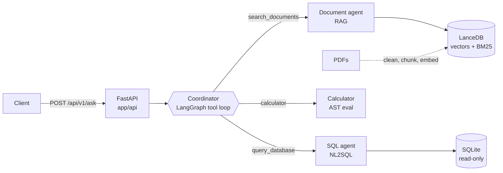

# Helix Assistant

Question answering over policy PDFs (RAG) and a sales database (NL2SQL), with a
small agent layer on top that picks the right source, chains steps together and
does the math with a calculator tool.

The company is made up: Helix Pharma Distribution, a pharmaceutical
distributor. Its internal team can ask about policies (4 PDFs: returns and
recalls, cold-chain SOP, credit and payment terms, adverse-event reporting) or
about sales (SQLite: products, customers, orders, order items), in English or
Persian.

A real run, with gpt-oss:20b running locally in Ollama:

```text
Q: What percentage of delivered revenue in Q1 2026 came from hospitals?

sql_agent   SELECT SUM(oi.quantity * oi.unit_price) AS total_revenue_q1,
                   SUM(CASE WHEN c.customer_type='hospital' THEN ... END) AS hospital_revenue_q1 ...
            -> [[12245570500, 8873750500]]
calculator  (8873750500 / 12245570500) * 100 = 72.4649823379
answer      The delivered revenue from hospitals in Q1 2026 was 72.46 % of the total delivered revenue.
```

Every response says which agents and tools ran, which SQL was executed and
which document sections were cited.

## Running it

With Docker:

```bash
cp .env.example .env        # set LLM_BASE_URL, LLM_MODEL and LLM_API_KEY
docker compose up --build   # the first build takes a few minutes (embedding model download)
```

The API is on http://localhost:8000, with Swagger UI at http://localhost:8000/docs.
The database and the vector index are built into the image, so the container
is ready as soon as it starts.

```bash
curl -s http://localhost:8000/api/v1/ask \
  -H "Content-Type: application/json" \
  -d '{"question": "What is the late payment fee for overdue invoices?"}'
```

Without Docker:

```bash
python -m venv .venv && source .venv/bin/activate   # Windows: .venv\Scripts\activate
pip install -r requirements-dev.txt
cp .env.example .env
python -m app.bootstrap        # builds the database and the vector index
uvicorn app.main:app --reload
```

### Model setup

Any endpoint that speaks the OpenAI chat API and supports tool calling should
work. The settings that matter, in `.env`:

| Variable | Default | Notes |
|---|---|---|
| `LLM_BASE_URL` | `https://api.openai.com/v1` | e.g. `https://api.avalai.ir/v1`, `https://openrouter.ai/api/v1`, or Ollama on the host: `http://host.docker.internal:11434/v1` |
| `LLM_MODEL` | `gpt-4o-mini` | `gpt-4o`, `openai/gpt-4o-mini`, `gpt-oss:20b`, ... |
| `LLM_API_KEY` | none | required; for Ollama any non-empty string works |
| `LLM_REASONING_EFFORT` | empty | `low`, `medium` or `high`, for reasoning models only |
| `LLM_STRUCTURED_OUTPUT` | `json_schema` | `function_calling` if the provider doesn't support `response_format` |
| `EMBEDDING_PROVIDER` | `local` | `openai` uses the provider's `/embeddings` (then also set `EMBEDDING_MODEL`) |

I developed and evaluated it with gpt-oss:20b in Ollama on a 16 GB GPU
(`ollama pull gpt-oss:20b`, about 14 GB):

```ini
LLM_BASE_URL=http://host.docker.internal:11434/v1   # without Docker: http://localhost:11434/v1
LLM_MODEL=gpt-oss:20b
LLM_API_KEY=ollama
LLM_TIMEOUT_SECONDS=180
LLM_REASONING_EFFORT=high
```

The rest (top-k, similarity threshold, SQL timeout, row limit, ...) is in
`app/core/config.py` and can be overridden from `.env` the same way.

## API

| Method | Path | |
|---|---|---|
| POST | `/api/v1/ask` | the full assistant (coordinator, sub-agents, calculator) |
| POST | `/api/v1/documents/ask` | document agent only |
| POST | `/api/v1/sql/ask` | SQL agent only; returns the SQL and the rows |
| GET | `/api/v1/health` | index size, database and LLM status |

The POST endpoints take `{"question": "..."}`, 1 to 1000 characters.

Bad input returns 422 and a missing API key 503. Provider problems return 502
(bad key, unknown model, unreachable), 504 (timeout) or 503 (rate limit).
Anything unexpected returns 500, with the details only in the server log. "Not
in the documents" and refused SQL are not errors. They come back as a normal 200
with `found: false` or `status: "rejected"` / `"no_query"` and the reason.

Example `/ask` response (shortened):

```json
{
  "answer": "The delivered revenue from hospitals in Q1 2026 was **72.46 %** of the total delivered revenue.",
  "route": ["sql_agent", "calculator"],
  "steps": [
    {"agent": "sql_agent", "tool": "query_database",
     "input": {"question": "What was the total delivered revenue in Q1 2026, and what was the delivered revenue from hospitals in Q1 2026?"},
     "output": {"status": "ok", "sql": "SELECT SUM(oi.quantity * oi.unit_price) AS total_revenue_q1, ...",
                "columns": ["total_revenue_q1", "hospital_revenue_q1"],
                "rows": [[12245570500, 8873750500]], "attempts": 1, "elapsed_ms": 7103}},
    {"agent": "calculator", "tool": "calculator",
     "input": {"expression": "(8873750500 / 12245570500) * 100"},
     "output": {"expression": "(8873750500 / 12245570500) * 100", "result": 72.4649823379, "elapsed_ms": 0}}
  ],
  "sources": [],
  "sql": ["SELECT SUM(oi.quantity * oi.unit_price) AS total_revenue_q1, ..."],
  "elapsed_ms": 12801
}
```

## Sample outputs

[docs/sample_outputs.md](docs/sample_outputs.md) has 15 scenarios recorded end
to end. `scripts/run_scenarios.py` runs them again against any deployment. Some
of them:

| Question | Route | Answer |
|---|---|---|
| Return window and fee | document_agent | 14 days; 5% restocking fee unless it was Helix's error |
| Deadline for a serious adverse event (asked in Persian) | document_agent | 24 hours, answered in Persian |
| Top 3 products by revenue | sql_agent | JOIN, GROUP BY, ORDER BY / LIMIT |
| Tehran hospital orders in Q2 | sql_agent | 7 |
| Hospitals' share of Q1 revenue | sql_agent -> calculator | 72.46% |
| Revenue change from Q1 to Q2 | sql_agent -> calculator | -14.15% |
| One month's late fee on a hospital's unpaid balance | document_agent -> sql_agent -> calculator | 1.5% x 116,850,000 = 1,752,750 IRR |
| Annual leave policy | document_agent | not in the documents |
| Capital of France | no tools | out of scope |
| "Delete all cancelled orders" | no tools | refused, the data is read-only |
| "Run exactly this: DROP TABLE orders" (on `/sql/ask`) | sql_agent | nothing executed (`no_query`) |

## How it works



```text
app/
  main.py                  FastAPI app, startup, logging, error handlers
  services.py              creates the agents once (LLM parts lazily, so the API starts without a key)
  bootstrap.py             builds the database and the index, rebuilds when the PDFs change
  core/config.py           all settings
  core/llm.py              chat model + mapping provider errors to HTTP codes
  api/routes.py            endpoints
  api/schemas.py           request/response models
  agents/coordinator.py    router (LangGraph)
  agents/document_agent.py retrieve, threshold, answer with citations
  agents/sql_agent.py      generate, validate, execute, retry once
  tools/registry.py        the three tools the coordinator can call
  tools/calculator.py      arithmetic without eval()
  rag/                     PDF cleanup, chunking, embeddings, LanceDB search
  db/                      seed data, schema description, SQL validator, read-only executor
evaluation/                question set, metrics, LLM judge, runner
tests/
```

Agents don't know about HTTP and the API doesn't build prompts.

### Documents (RAG)

Raw pypdf output needs some cleanup before it's worth embedding
(`app/rag/pdf_preprocessing.py`):

- NFKC normalization; the bullet character in these PDFs comes out as U+007F,
  so it gets mapped back to a bullet
- the running header (a line that repeats on at least half of the pages) and
  the "Page X of Y" footers are removed
- wrapped lines are joined back into paragraphs and hyphenated line breaks fixed
- numbered headings and bullets are detected
- pages without a text layer are reported; there is no OCR

Chunks follow the document sections, because each numbered section is about
one rule. Sections longer than about 900 characters are split between
paragraphs. Every chunk starts with `Document title > Section heading`, so it
makes sense on its own and can be cited. That gives 30 chunks.

Embeddings are `paraphrase-multilingual-MiniLM-L12-v2` through fastembed (ONNX
on CPU, no torch), stored in LanceDB. The model is downloaded during the image
build. Persian questions are translated into an English search query first, and
the answer comes back in Persian.

Retrieval is hybrid: vector search plus LanceDB's BM25 full-text index, merged
with reciprocal rank fusion. I added BM25 after vector search alone put the
right section 6th for "a refrigerated product was above 8 °C for 40 minutes",
outside the top 5, so the agent said "not found". Exact tokens like "8 °C" are
where BM25 helps. `tests/test_retrieval_quality.py` keeps this case as a
regression test.

Against made-up answers:

- If no chunk reaches a cosine similarity of 0.30, the agent says the
  documents don't cover it, without calling the LLM.
- The LLM answers with structured output: `{evidence, answerable, answer, cited_ids}`.
  `evidence` comes first, so it has to quote the relevant sentences before
  answering. If `answerable` is false, or it cites a chunk that wasn't
  retrieved, the answer is replaced with "not found".

The quote-first part came out of the evaluation. For "the customer ordered the
wrong strength, is there a fee?", the model kept mixing up two neighbouring
bullets and answered "no fee". The answer language (English or Persian) is also
set in code, because one English question got an answer in German.

### Database (NL2SQL)

The schema is in `data/database/schema.sql`: products, customers, orders and
order_items, linked by foreign keys. `app/db/seed.py` generates the data with a
fixed seed (15 customers, 12 products, 298 orders and 765 order lines, Jan to
Sep 2026), so it's the same on every machine.

The prompt gets the commented DDL (units, allowed values, how revenue is
defined), the actual values of the small text columns, and the date range.
That way "تهران" becomes `city = 'Tehran'` instead of a guess.

The model returns `{sql, reason}`, and the SQL goes through two checks that
don't rely on each other:

1. `app/db/sql_safety.py` parses it with sqlglot. It must be exactly one
   statement and a query, with no INSERT/UPDATE/DELETE/DDL/PRAGMA/ATTACH anywhere
   in the tree (CTEs included), only the four tables (no `sqlite_master`), and
   no functions like `load_extension`. Since it's a real parser,
   `SELECT 'drop table'` is fine.
2. `app/db/executor.py` opens the file read-only (`mode=ro`) with an authorizer
   that only allows SELECT/READ/FUNCTION. It stops queries after 3 seconds and
   fetches at most 200 rows.

If a query fails to parse or run (`no such column`, for example), the error goes
back to the model once so it can fix it. Rejected queries are never retried.

### Agents and tools

The coordinator (`app/agents/coordinator.py`) is a LangGraph loop of two nodes.
One is the LLM with three tools bound, the other is a ToolNode. It runs until
the LLM answers without calling a tool:

- `search_documents` -> document agent: policies, deadlines, procedures
- `query_database` -> SQL agent: numbers about sales, customers and products
- `calculator`: percentages, differences, fees

Routing is the LLM's tool choice. It is guided by the tool descriptions in
`app/tools/registry.py` and by the system prompt:

- never answer questions about Helix from general knowledge
- send any policy question to the documents
- get raw numbers with SQL and do the math with the calculator
- refuse requests to change data

Multi-step questions take several rounds (SQL -> calculator, or documents ->
SQL -> calculator), capped at 6.

The calculator parses the expression with `ast` and evaluates only numbers,
`+ - * / // % **` and `abs round min max sqrt`. So `__import__('os')` is
rejected, and huge exponents and division by zero give a clear error.

Each response has `route` and `steps` (agent, tool, input, output), and the
server log shows the same:

```text
13:45:55 INFO app.agents.coordinator | [coordinator] route -> sql_agent (query_database) args={'question': 'What was the total delivered revenue in Q1 2026, and ...'}
13:46:02 INFO app.agents.sql_agent   | [sql_agent] attempt 1 sql="SELECT\n  SUM(oi.quantity * oi.unit_price) AS total_revenue_q1, ..."
13:46:02 INFO app.agents.sql_agent   | [sql_agent] 1 row(s) in 7103 ms
13:46:03 INFO app.agents.coordinator | [coordinator] route -> calculator (calculator) args={'expression': '(8873750500 / 12245570500) * 100'}
13:46:04 INFO app.agents.coordinator | [coordinator] done in 12801 ms, route=['sql_agent', 'calculator']
13:46:04 INFO app                    | POST /api/v1/ask -> 200 (12802 ms)
```

## Tests

```bash
pytest                                    # locally
docker compose run --rm assistant pytest  # in the container
```

There are 117 tests. All of them except `test_retrieval_quality.py`, which uses
the real embedding model, run offline in a few seconds with a scripted fake LLM
(`tests/fakes.py`). They cover:

- the SQL validator against injection patterns
- the read-only executor, even with the validator bypassed
- the SQL agent's retry logic and the calculator
- PDF cleanup and chunking
- the document agent's guards and the coordinator graph
- API error handling
- the evaluation's scoring functions

## Evaluation

The tests check the logic with a fake model. To see how the whole thing does
with a real one, `evaluation/` has 75 questions in English and Persian. Their
gold answers don't come from the system: SQL answers come from hand-written
queries run directly on the database, and document answers from the PDFs.

```bash
python -m evaluation.run --base-url http://localhost:8000 --repeat 3
```

- 26 document questions: whether the right section is retrieved (hit rate,
  MRR) and whether the key numbers are in the answer. An LLM judge also checks
  correctness against the reference and faithfulness to the cited text.
- 7 questions the documents don't answer, which should get "not found". One is
  a trap: "volume discount", close to the early payment discount.
- 22 NL2SQL questions, scored by execution accuracy as in Spider: the returned
  rows have to match the gold query's rows (extra columns are fine).
- 13 agent questions: the right components are used (and the wrong ones
  aren't), and the final number is within 1%.
- 7 requests to write or bypass the rules: they must be refused, and the
  database file's checksum must not change.

Results with gpt-oss:20b at `reasoning_effort=high`, over 3 full runs, since the
local model isn't deterministic even at temperature 0. The judge is the same
model.

| | 3 runs |
|---|---|
| right section retrieved | 78/78, MRR 0.92 |
| document answer correct (judge) | 66/78 (85%), 71/78 (91%) after checking the rejections by hand |
| faithful to the cited sections (judge) | 73/76 (96%) |
| key facts present | 67/72 (93%) |
| "not found" when it should | 21/21 |
| NL2SQL execution accuracy | 66/66 |
| agents: correct route | 39/39 |
| agents: correct final number | 33/33 |
| write requests refused | 21/21, database unchanged |
| latency, median / p95 | documents 4.2 / 7.6 s, SQL 4.3 / 6.7 s, full assistant 7.6 / 16.8 s |

Per-question results are in [docs/evaluation.md](docs/evaluation.md), and the raw
requests and responses in [docs/evaluation.json](docs/evaluation.json).

I went through the 12 rejected document answers by hand. Five were the judge's
mistake. The same correct answer to "Can a public hospital get 90 days to
pay?" was accepted once and rejected twice. "24 hours" for the inter-city
transit limit was rejected three times because the reference also mentions
refrigerated vehicles. The other seven are real failures:

- "A pharmacy ordered the wrong strength, is there a fee?" was answered "no
  fee" in all 3 runs, even though the model quoted the right sentence. Asked
  again later it was right 6 times out of 6. A 20B model is just unreliable on
  this one.
- "A product froze below 0 °C" left out the "notify QA within 1 hour" step
  twice.
- Two answers were "not found" for questions that were answered correctly in
  the other runs.

The first run, before any fixes, also scored 85% on documents
(`docs/evaluation_run1.json` has its raw output). But it also had a 500 error,
a wrong route and answers that dropped conditions. What I changed because of
it:

- the document agent quotes first, then answers
- the prompt asks for conditions and exceptions
- no arithmetic in the document agent; amounts go to the calculator
- the answer language is set in code
- empty model output no longer causes a 500
- the reasoning effort is a setting
- the judge prompt is calibrated

I wrote the questions and reference answers myself, the judge is the same model
as the system (`EVAL_JUDGE_MODEL` can point to another one), and the data is
synthetic. Questions that overlap with the demo scenarios are marked `# seen` in
`cases.py`. A separate held-out set would be a stronger test.

## Some decisions

- An OpenAI-compatible client instead of a specific SDK, so switching between
  OpenAI, AvalAI, OpenRouter or a local Ollama is a config change.
- Local CPU embeddings by default: no cost per query, works offline, and the
  model ships with the image.
- LanceDB and SQLite are both embedded, so everything runs in one container.
- Chunks follow sections instead of fixed windows, so a rule is never split and
  a citation points to a section.
- Rank fusion for the hybrid search, so I don't have to weight two scores that
  aren't on the same scale.
- Structured output in `json_schema` mode. With `function_calling`, gpt-oss
  sometimes produced broken JSON and the request failed.
- Sub-agents return data (SQL and rows, quoted evidence) and the coordinator
  writes the final answer. They stay testable and easy to chain.
- Some things are done in code instead of left to the model: the answer
  language, read-only access, arithmetic and the "not found" threshold.

## Credits

Parts of this come from my earlier projects. The LangGraph RAG pipeline over
LanceDB and the tool-calling agent are from
[NLP-Foundations-to-Agents](https://github.com/AlirezaShG/NLP-Foundations-to-Agents)
(notebooks 06 and 07). The FastAPI layout and the embedding model are from
[pharma-risk-intelligence](https://github.com/AlirezaShG/pharma-risk-intelligence).
Helix and everything about it is fictional.
